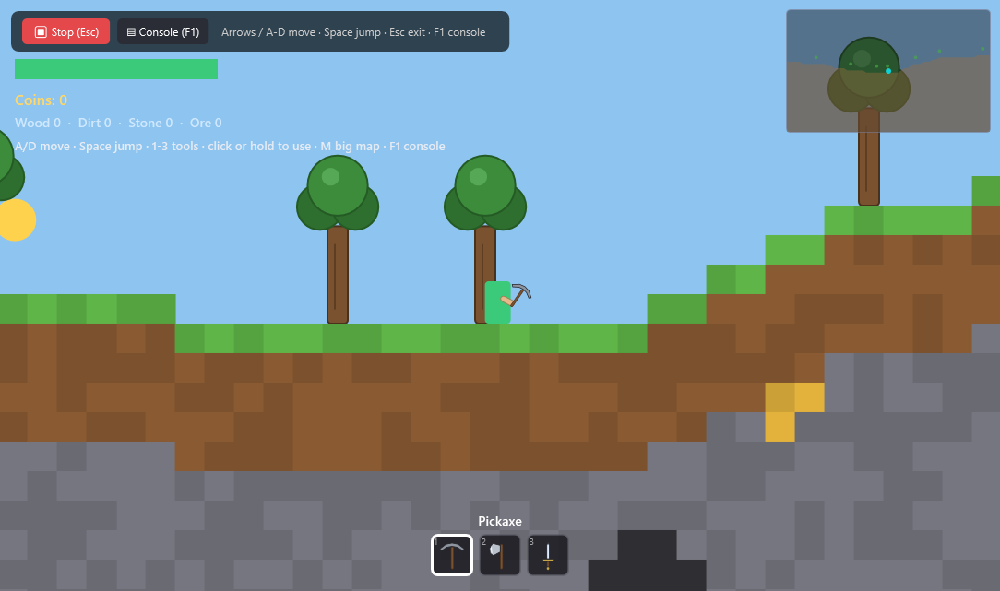
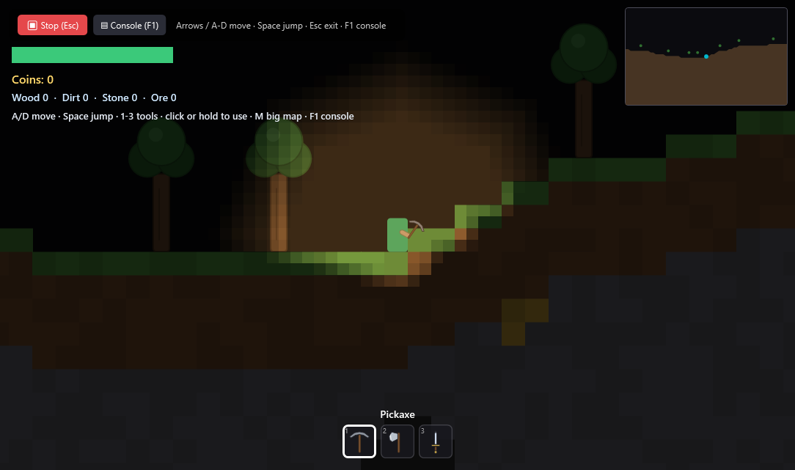
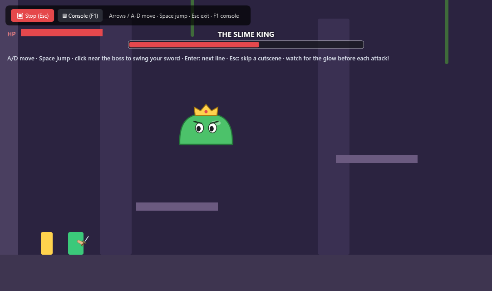
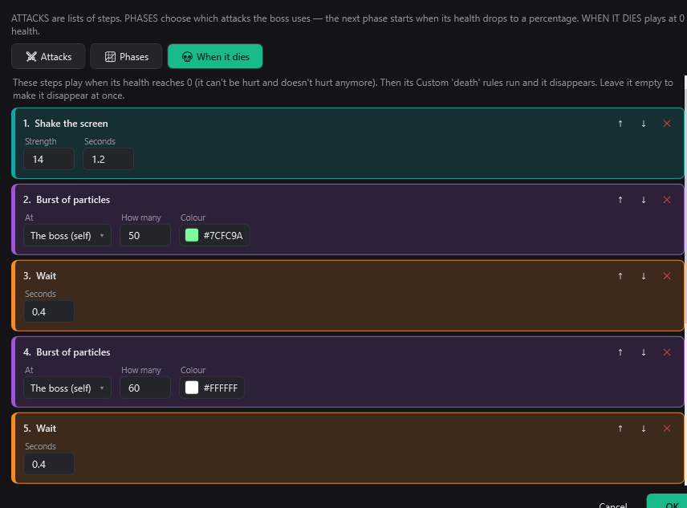

<p align="center">
  
</p>

<h1 align="center">EasyEngine</h1>

<p align="center">
  <b>The easiest 2D game engine.</b> You bring the art, build the scene by dragging things around,<br>
  and describe in plain words what each thing does — <b>the AI turns it into game logic.</b>
</p>

<p align="center">
  <a href="https://github.com/tarl3s/EasyEngine/releases/latest/download/EasyEngine-win-x64.zip">
    
  </a>
  <br>
  <sub><a href="https://github.com/tarl3s/EasyEngine/releases/latest">Latest release &amp; what's new</a> · <a href="README.pt-BR.md">Leia em português</a></sub>
</p>

<p align="center">
  
  
</p>

---

## Why EasyEngine

Making a game shouldn't require being a programmer. EasyEngine is for people who love making games but don't enjoy
writing code: pick ready-made behaviors from lists, snap blocks together, or just tell the AI what you want
("jumps, and every third jump does a dash") — and press ▶ Test.

It's free, it runs on your own computer, and the AI can be a free cloud one or fully offline.

## Get started

1. **[Download EasyEngine](https://github.com/tarl3s/EasyEngine/releases/latest/download/EasyEngine-win-x64.zip)** (Windows 10/11, 64-bit).
2. Unzip it anywhere and open **`EasyEngine.exe`**. Nothing else to install.
   - Windows may say *"Windows protected your PC"* because the app isn't signed yet: click **More info → Run anyway**.
3. Three sample games are ready in **Recent projects** (also in `Documents\EasyEngine Samples`):
   **Top-Down Demo**, **Boss Demo** and **Infinite World**. Open one, press **▶ Test**, then look at how it's made.

**Updates are automatic:** when a new version is out, EasyEngine asks if you want it, then downloads it, replaces the
old version and opens again. Your projects are never touched. The sample games are refreshed with each version
(if you edited one, your copy is kept as *"(your copy …)"*).

## What it can do

- **Visual scene editor** — drag and drop, resize (keeping proportions if you want), arrow-key nudge, grid/snap, layers
  (including UI layers fixed to the screen), front/back order inside a layer, lock objects so they stay put, zoom,
  movable panels, undo/redo, multiple scenes.
- **The AI does the logic** — select an object, describe what it should do, and the AI applies real behaviors.
  **🔨 Build** edits the game, **💡 Brainstorm** talks ideas through, **🎓 Learn** teaches you how to use anything
  (every behavior card has a **?** that asks it directly).
- **Ready-made behaviors** — platformer (variable jump, coyote time, double jump, wall jump, dash), top-down, chase,
  patrol (even along a route you draw), health/damage/knockback, items you swing (sword, axe, pickaxe, your own),
  hotbar, shops and crafting, collectibles (worth points), doors between scenes, springs, pushable blocks, turrets that
  aim, keeping things inside the screen, and more.
  Every setting is **picked from a list** — no syntax to learn.
- **🧩 Blocks for custom logic** — Scratch-style *when → do* blocks, with global, scene and per-object variables
  (numbers, yes/no, text, colours and lists), an inventory and dialogue. Describe what you want and **✨ the AI adds the
  blocks**, or start from a **📚 recipe** (fade out, blink, follow the mouse, move in a circle, a countdown…).
- **👑 Boss AI** — bosses with **phases by health**, attacks built from steps (warn, dash, jump with a shockwave,
  ring/spread/aimed shots, summon minions, invulnerable…), a death sequence and a boss health bar.
- **🎬 Cutscenes** — dialogue, camera moves, big titles, fades, cinema bars, moving characters, locking the controls;
  triggered on start, entering an area, a variable or a key.
- **✨ Ask the AI** inside the Boss and Cutscene editors: describe it, the AI writes the steps.
- **World** — AABB physics (hitboxes can fit the drawing, ignoring a sprite's empty margins), one-way and moving
  platforms, tilemaps (breakable, with tiles you draw or animate), **procedural generation**, and a
  **terrain generator** (hills, caves, ores, trees, plus your own blocks — clouds, deeper ores, biomes) you can mine,
  endless or with a size you choose.
- **Day & night and lighting** — sun and moon, torches and lamps, darker underground, and **pixel-style
  block lighting** where walls stop the light and torches colour what they touch. **Minimap** with a big map on a key.
- **Look and feel** — sprite animations, a built-in **pixel-art editor**, particles, tweens with easing, bars,
  text effects, dialogue box styles, sound with volume channels.
- **Debug console (F1)** — see what your game is doing: clicks, hits, rules that fired, sounds, warnings.
- **Export** your game as a standalone `.exe`.
- **Your language, your look** — the editor speaks English, Portuguese (Brazil and Portugal), Spanish, French, German,
  Japanese and Chinese (Simplified and Traditional), and the AI answers you in it. Dark or light theme, bigger or smaller
  interface, and a button that clears the engine's temporary files (⚙ Settings).

<p align="center">
  
  
</p>

## The AI

Open the AI panel and pick **Which AI to use**:

- **Free cloud AI** (Groq, Google Gemini or OpenRouter): make a free account, paste the key — the app guides you.
  Fast and smart, no credit card. Add more than one key: when one runs out for the day, the next one takes over.
- **Offline AI** with [Ollama](https://ollama.com): runs on your computer, nothing leaves it. Smaller models work
  (the engine is built to cope with them).
- **Your own paid account** (OpenAI, Claude, DeepSeek, Mistral, or any OpenAI-compatible endpoint).

The AI never writes code into your game: it answers with the engine's own behaviors and settings, which the editor
checks — and tidies up — before applying. It is measured against ~80 typical requests (moving things, timers,
enemies, bosses, a whole level, questions…) played back to see that they really work. Keys stay on your computer (`%APPDATA%\EasyEngine\settings.json`).

## Build from source

Needs Windows and the [.NET 8 SDK](https://dotnet.microsoft.com/download/dotnet/8.0).

```bash
dotnet build
dotnet run                      # the launcher
dotnet run -- --play my.eeproj  # play a project without the editor
dotnet run -- --fulltest        # the full headless test suite (log in %TEMP%\easyengine_fulltest.log)
```

Other modes: `--e2e`, `--behtest`, `--exprtest`, `--blocktest`, `--aijsontest`, `--selftest`, `--review`, and the
demo builders `--topdown`, `--bossdemo`, `--infinite`, `--mining`, `--makegame`, `--scenarios`.
Releases are made with `tools/Publish-Release.ps1`. Contributors (and AI coding assistants) should read
[AGENTS.md](AGENTS.md) first.

## License

[MIT](LICENSE) — free to use, change and share, including in commercial games.
